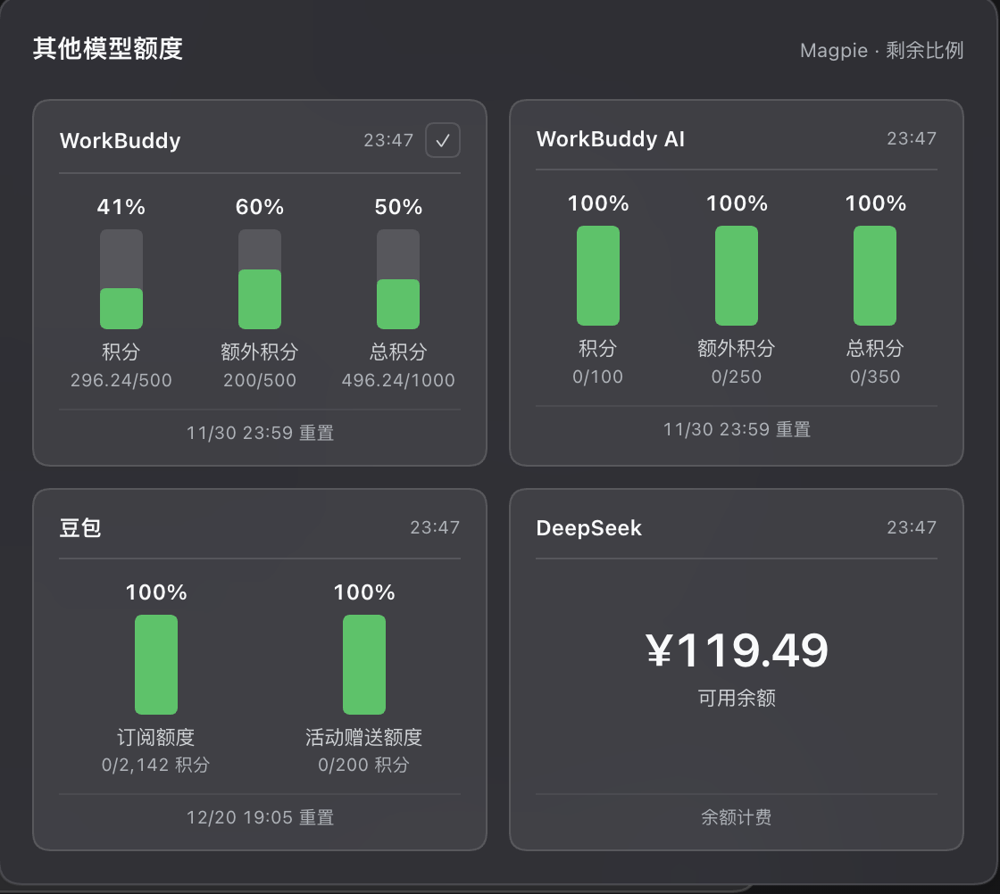

# dsh-usage-rings（用量环）

[English](README.en.md)

为 [DeepSeek Harness](https://github.com/deepseek-ai/dsh) 提供输入框底栏统计控件与本地 Magpie 网关额度监控插件。

## 界面预览




## 功能

- **底栏左侧统计控件**（从左到右）：
  - **上下文**：环形显示上下文窗口估算占比，点击展开系统提示词、工具定义与对话消息构成。
  - **缓存**：显示本会话缓存命中率，展开查看缓存读 / 未缓存输入 / 缓存写分布及输入量前 4 模型的各自命中率。
  - **Tok/s**：显示输出速率、轮次与步骤数、模型/工具耗时占比、首响平均、正在使用/下一步模型（自动将 `group/*` 智能路由展开为实际模型）以及本会话各模型 Token 用量（`usageByModel` 投影）。
- **底栏右侧额度监控**：
  - **Codex / Gemini 额度环**：自动跟随 `~/.config/magpie/usage.jsonl` 中当前服务的账号显示最紧窗口剩余比例，展开查看各时间窗口与 Codex 重置卡。
  - **其他模型额度**：弹窗按平台分组以竖向柱状表卡片展示（如 WorkBuddy、WorkBuddy AI、豆包），余额制平台（如 DeepSeek）展示居中余额卡片，并支持触发 WorkBuddy 签到。

## 前置依赖与说明

- 需要 **DSH >= 0.2.0**。
- **依赖本地 Magpie 网关**：额度环、重置卡、WorkBuddy 签到及 `group/*` 路由反解通过本地 `http://127.0.0.1:3425/v1/magpie/*` 与 `~/.config/magpie/usage.jsonl` 获取；未运行 Magpie 时，左侧上下文、缓存、Tok/s 仍可正常工作，额度环显示 `—`。
- 本插件会接管 `conversation.composer.dock` 中宿主自带的 `activity` 与 `usage` 统计条目。

## 安装

推荐优先通过 **npm** 安装：

- 在 DeepSeek Harness 客户端中打开 **插件 → 添加插件**，输入 `dsh-usage-rings` 安装并启用；
- 或通过 DSH 命令行安装：

```sh
dsh plugin add dsh-usage-rings
```

同时保留 **GitHub** 安装通道：

```sh
dsh plugin add https://github.com/sevenqcx/dsh-usage-rings
```

安装或更新后请完全退出并重启一次 DSH，以加载宿主投影与前端快照。

## 测试

```sh
npm test
```

（若本机不存在 `~/.dsh/sessions` 本地会话缓存，`real-session.test.js` 会自动跳过。）

## 许可证

MIT
